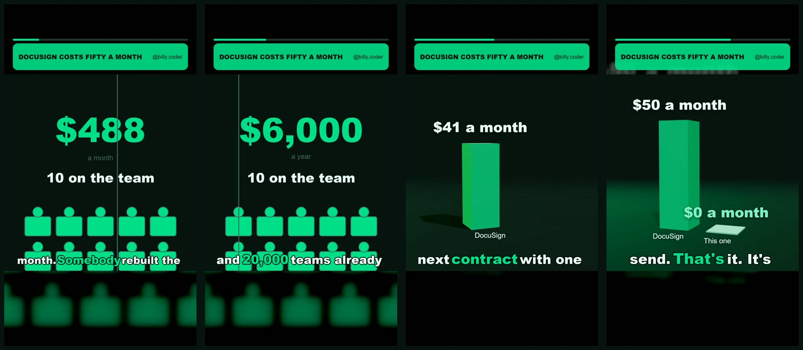
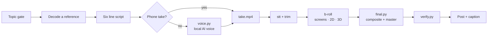

<div align="center">

# Reel Boss

**A Claude skill that directs, builds and checks short vertical reels, end to end, on your own machine.**

Topic gate · six line script · local AI voice · 2D and 3D motion b-roll · captions · loudness mastering · delivery verification

[](https://github.com/TMSifat/reel-boss/actions/workflows/ci.yml)




<sub>Frames from a reel built entirely by the pipeline: script read by the local voice, seat-cost counter, 3D price bars, kinetic captions.</sub>

</div>

---

## Why

Built for [@billy.coder](https://instagram.com/billy.coder), where one reel built
this way took the account from 79 to 669 followers. Measured across its last 12
posts, comment rate is flat at **2.16%** while views range **89 to 89,480**. The
conversion half was never the problem; **the topic is the whole game**, so Reel
Boss gates the topic before anything is shot, then makes the build and the
checks impossible to skip.

## What it does

| | |
|---|---|
| 🎯 **Topic gate** | Scores an idea on what actually separated the hits from the flops, before anything is shot |
| ✍️ **Direction** | The four beats, 20 hook patterns, the six line script, the recording pack, the caption funnel |
| 🎙️ **Local AI voice** | No phone take? Kokoro reads the script on your CPU. No account, no credits |
| 🎬 **Edit pipeline** | Cuts derived from the transcript, trimmed against measured silence, mastered to -14 LUFS |
| 🧊 **3D b-roll** | three.js price bars and `.glb` turntables, rendered frame by frame |
| ✨ **Eased motion** | Plates fade and rise, the spoken caption word pops, counters ease instead of stepping |
| ✅ **Verification** | Checks the delivered file, not the build log: voice present, a/v sync, loudness, script match |
| 🛡️ **Guards** | The repo name never shows, no reused CTA keyword, no em dashes, no silent fallbacks |

Everything is free and local. Nothing in the pipeline calls a paid service.

## How a reel gets made



## Install

### As a Claude Code skill

```bash
git clone https://github.com/TMSifat/reel-boss.git ~/.claude/skills/reel-boss
cd ~/.claude/skills/reel-boss
pip install -r requirements.txt
python -m playwright install chromium
python scripts/doctor.py
```

Then start a new session and say *"make a reel"*, or type `/reel-boss`.

### On claude.ai

Download the repository as a zip (**Code → Download ZIP**), rename the top
folder inside it to `reel-boss`, and upload it under **Settings → Skills**.

### Requirements

- Python 3.11+ and **ffmpeg with ffprobe** on PATH
  (`winget install Gyan.FFmpeg` · `brew install ffmpeg` · `apt install ffmpeg`)
- Node.js, for yt-dlp's YouTube support
- Bash for `scripts/lint.sh` (Git Bash on Windows)
- About 350 MB for the voice model, downloaded once on first use

`scripts/doctor.py` checks every one of these and prints the exact fix.

### First run

```bash
cp reel-system/keywords_burned.template.txt reel-system/keywords_burned.txt
```

Seed it with every CTA keyword your account has ever used. It is git-ignored,
so pulls never touch it. Emoji plates need Apple emoji baked on a Mac; see
[`reel-system/assets/emoji`](reel-system/assets/emoji/README.md).

## Quick start

```bash
# 1. gate the topic
python scripts/topic_gate.py

# 2. open the reel (claims the CTA keyword)
cd reel-system
python newreel.py docusign-swap --palette money --cta SIGNIT --banner "DocuSign costs fifty a month"

# 3. write the six lines into projects/docusign-swap/reel.json, then either
#    drop your phone take in as take.mp4, or let the local voice read it
python voice.py projects/docusign-swap

# 4. transcript, trim, b-roll
python stt.py  projects/docusign-swap/take.mp4
python trim.py projects/docusign-swap/take.mp4
python renderers/scene3d.py projects/docusign-swap/broll_1.mp4 bars \
    --bar "DocuSign|50" --bar "This one|0" --prefix "$" --suffix " a month"

# 5. build, then check the file that actually shipped
python final.py  projects/docusign-swap
python verify.py ~/Documents/Notes/video-assets/docusign-swap.mp4 --project projects/docusign-swap
```

Full stage list, every renderer and what each guard protects:
[`references/pipeline.md`](references/pipeline.md).

## B-roll renderers

| Renderer | What it draws |
|---|---|
| `screenrec.py` | A real web page in headless Chromium, with the repo name blurred from the first painted frame |
| `seatcost.py` | A per seat bill that fills up, flips to annual, then drops to zero |
| `graphic.py` | A scan grid where tiles light up and a share get flagged |
| `plate.py` | Typographic statement rows that land one at a time |
| `scene3d.py` | 3D price bars, or a turntable of any `.glb` model |

## Configuration

Machine-specific paths are environment variables, never edits:

| Variable | Default | Purpose |
|---|---|---|
| `REEL_DELIVERY` | `~/Documents/Notes/video-assets` | where finished reels land |
| `REEL_COOKIE_BROWSER` | `chrome` | browser cookies for reference pulls (`firefox` on Windows) |
| `REEL_VOICE_MODELS` | `~/.cache/reel-boss/kokoro` | voice model cache |
| `REEL_FONT_BOLD` / `_REG` / `_MONO` | Arial Black / Arial / Consolas or Menlo | fonts |
| `REEL_BURNED_KEYWORDS` | `reel-system/keywords_burned.txt` | CTA keyword ledger |

## Repository layout

```
SKILL.md                 the direction system Claude follows
references/              evidence, hook sheet, pipeline, traps and setup
scripts/                 topic_gate.py · lint.sh · doctor.py
reel-system/             the build pipeline
  voice.py stt.py trim.py matte.py final.py verify.py ...
  renderers/             screenrec · seatcost · graphic · plate · scene3d
  lib/                   util.py (guards) · ease.py (motion)
  assets/three/          vendored three.js 0.170.0
```

## Credits

[three.js](https://threejs.org) (MIT) ·
[Kokoro](https://huggingface.co/hexgrad/Kokoro-82M) via
[kokoro-onnx](https://github.com/thewh1teagle/kokoro-onnx) (Apache 2.0) ·
[faster-whisper](https://github.com/SYSTRAN/faster-whisper) (MIT) ·
[Playwright](https://playwright.dev) (Apache 2.0) ·
[FFmpeg](https://ffmpeg.org) · [yt-dlp](https://github.com/yt-dlp/yt-dlp)

## License

[MIT](LICENSE) © 2026 Tanvir Mustabi Sifat. Voices made with `voice.py` are
synthetic: switch on Instagram's AI label when you post one.
